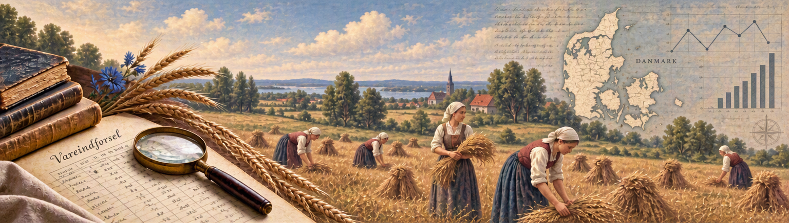

{width="100%"}

I am a researcher at the Department of Economics, University of Southern Denmark. My research focuses on economic history, with a particular interest in economic growth and human capital formation. I have worked on topics including Malthusian mechanisms, long-run economic growth, and market integration.

In a single-authored paper, I examine a land redistribution policy implemented in Italy in the 1950s and its effects on female labour force participation. I have also conducted research on social mobility in Norway, the Faroe Islands, and Schleswig-Holstein.

More recently, I joined a project aimed at transcribing and harmonising historical Danish trade statistics. I have also been involved in a large collaborative project based on a longitudinal tourism dataset, where I explored patterns of geographic mobility.

My research combines quantitative methods with detailed archival work and the construction of novel historical datasets from sources such as manorial accounts, biographies, student records, and trade statistics. Through this work, I have developed expertise in recovering, classifying, and analysing information from a wide range of historical sources.

More recently, I have expanded my methodological toolbox through projects applying machine learning and large language models to economic history, opening new opportunities for large-scale source analysis and historical research.

